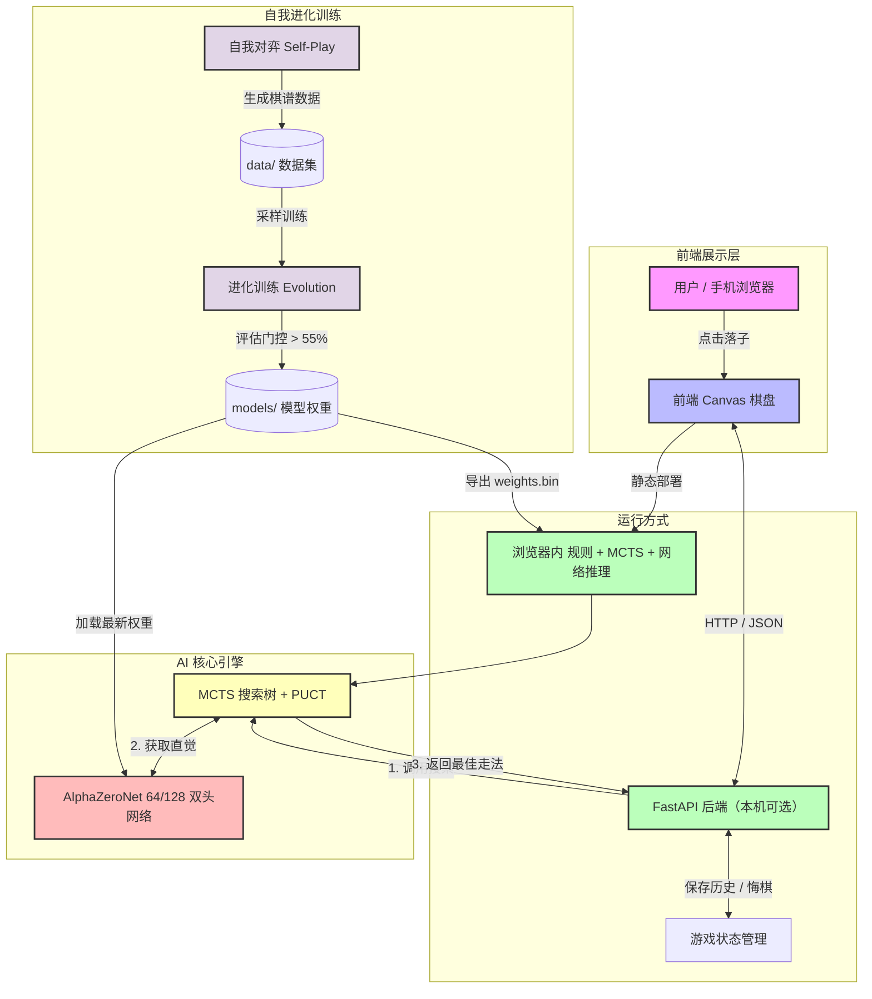

#  AlphaZero 黑白棋 AI

[](https://github.com/C3685082503/othello_ai/actions/workflows/tests.yml)
[](https://github.com/C3685082503/othello_ai/actions/workflows/pages.yml)


深度强化学习系统，不依赖任何现成的 MCTS、强化学习库。涵盖：游戏规则引擎、传统博弈 AI、策略/价值双头神经网络、蒙特卡洛树搜索（MCTS）、自我对弈进化闭环。

## 📖 项目简介

本项目是我在大一上9-10月完成的深度强化学习与博弈算法实战项目。项目以黑白棋（Othello）为载体，完整复现了 DeepMind 的 AlphaZero 核心思想：用神经网络提供直觉（策略），用搜索算法进行计算（MCTS），通过自我对弈实现持续进化。

相比于直接调用 API 或框架，本项目重写了所有核心算法，旨在大致了解搜索、强化学习、神经网络和工程部署的底层逻辑。

## 🌐 浏览器版（在线试玩）

为了让项目「随时可分享」，另外实现了一个**纯前端版本**：棋盘、规则、MCTS 与神经网络推理全部跑在浏览器里，没有后端、没有网络请求。

- **在线版**（启用 Pages 后）：<https://c3685082503.github.io/othello_ai/>
- **本地预览**：`python -m http.server 8765 --directory web` → <http://127.0.0.1:8765/>
- **单文件离线版**：`node tools/build_single.mjs` → `dist/othello-offline.html`（约 5.8 MB，双击即玩，可微信直发）

打开页面会先弹出规则卡片：模型还在下载时按钮显示「模型加载中…」，就绪后变成「开始对局」；之后随时可以点「规则」重看，按 Esc 或点遮罩也能关闭。

权重由 `src/scripts/export_web_weights.py` 从 `models/alphazero_net.pth` 导出，JS 前向与 PyTorch 逐值对齐（容差 2e-4）。本机实测单次推理约 5 ms，160 次模拟约 1 秒，不需要 GPU。部署、更新模型与常见问题见 [部署与分享](docs/DEPLOY.md)。

## 🏗️ 技术架构



两种运行方式共用同一套规则与同一份权重：FastAPI 版适合本机调试与换模型，浏览器版适合长期分享。

项目采用标准 src/ 结构进行模块化管理：

```text
othello_ai/
├── src/                        # Python 端：训练 / 传统 AI / 本地服务
│   ├── game_engine/            # 规则引擎（纯 Python 版 + Numba 加速版）
│   ├── agents/                 # 随机、贪心、Minimax、Alpha-Beta、纯策略网络
│   ├── alphazero/              # 网络、编码器、MCTS、自我对弈、进化训练
│   ├── scripts/                # 对战脚本 + export_web_weights.py（导出浏览器权重）
│   └── web/                    # FastAPI + 原静态页面（本机对局）
├── web/                        # 浏览器版静态站点（部署到 GitHub Pages）
│   ├── engine.js               # 规则引擎（与 board.py 逐条等价）
│   ├── net.js                  # 手写前向推理，零依赖
│   ├── mcts.js                 # PUCT 搜索，分片让出主线程
│   ├── app.js                  # 对局 UI（画板、动画、悔棋、难度）
│   ├── weights.bin/weights.json# 由 PyTorch 导出的权重与元信息（含 sha256）
│   └── index.html / style.css
├── tools/build_single.mjs      # 单文件离线版构建
├── tests/                      # pytest 用例 + tests/js（Node 原生测试）
├── data/                       # 训练数据与断点存档
├── models/                     # 神经网络权重（含 baseline 历史模型）
├── docs/                       # 技术报告 / 实验记录 / 用户手册 / 部署说明
└── .github/workflows/          # tests.yml（Python）+ pages.yml（静态站发布）
```

## ✨ 核心特性

- 重写 MCTS：实现了 Selection、Expansion、Evaluation、Backpropagation 四步搜索，并基于 PUCT 公式平衡探索与利用。
- 动态残局特训：在棋盘剩余空格少于 12 个时，自动将 MCTS 模拟次数从 200 提升至 800，极大增强了残局计算能力。
- 完全贪心实战：实战阶段强制选择访问次数最多的走法，杜绝随机失误。
- 数据增强与多样性：采用温度衰减（前10步 1.0，10-20步 0.5，之后 0.1）和 Dirichlet 噪声，保证自我对弈数据的多样化。
- 纯前端推理：把 PyTorch 权重导出成 4.3 MB 的 float32 二进制，用约 150 行零依赖 JS 重写前向，单次 5 ms；同一套 MCTS 移植到 JS 后 160 次模拟约 1 秒，可完全离线运行。
- 残局精算：空位 ≤ 11 时不再依赖网络估值，直接 alpha-beta 穷举到终局（10 格 7–36 ms），消掉最后几手的送分。
- 加载与搜索优化：权重按 512 KB 分块下载、单块失败重试、边下边显示实时进度；MCTS 复用上一棵搜索树，减少重复展开与估值。
- 工程化保障：支持断点续跑、自动评估门控、网络结构动态升级（32/64 升级至 64/128）；浏览器端有权重 sha256 校验与 PyTorch 逐值对齐测试。

## 📊 实验结果

| 对手 | 模拟次数 | 胜率 | 说明 |
| :--- | :--- | :--- | :--- |
| 贪心 AI | 100 | 100% | 基础测试，快速验证 |
| 旧版模型 | 50 | 86.67% | 进化训练后的自我超越 |
| Alpha-Beta 深度 5 | 200 | 12.50% | 200局大样本统计（25胜/172负/3平） |

> **实验结论**：在纯 Python 环境、MCTS 算力仅为 Alpha-Beta 深度5 的 1/50 时，模型依然取得了 12.5% 的胜率。这证明了神经网络直觉在低算力环境下的有效性，同时也暴露了纯 Python 串行搜索的算力瓶颈。

## 🚀 快速开始
> 💡 **日常运行、公网演示与模型进化的完整指南，请查看：[用户手册](docs/USER_GUIDE.md)；浏览器版与 GitHub Pages 见：[部署与分享](docs/DEPLOY.md)**

### 1. 环境配置
pip install -r requirements.txt

### 2. 运行单元测试
python -m pytest tests/test_board.py -v

### 3. 生成自我对弈数据
python src/alphazero/self_play.py

### 4. 执行进化训练与评估
python src/alphazero/evolution.py

### 5. 挑战传统 AI
python src/scripts/play_evolved.py

### 6. 浏览器版（不需要显卡）
python -m http.server 8765 --directory web     # 打开 http://127.0.0.1:8765/
node tools/build_single.mjs                   # 或者构建单文件离线版

## 🛠️ 未来规划

- [x] Web 部署：浏览器内推理 + GitHub Pages，单步约 1 秒（160 次模拟）。
- [x] 单文件离线分发：权重内联，双击即玩（约 5.8 MB）。
- [ ] 浏览器端 int8 量化：把首屏权重从 4.3 MB 降到约 1.2 MB（需先做棋力评估）。
- [ ] 五子棋迁移：将 8x8 黑白棋扩展至 15x15 五子棋，调整网络输入与 MCTS 分支策略。
- [ ] 多进程自我对弈：利用多进程并行生成数据，提升训练效率。
- [ ] 服务端模型热更新：在保留浏览器版的同时，给 FastAPI 版加上权重热加载。

## 📚 参考资料
- Mastering the game of Go without human knowledge (AlphaGo Zero)
- Mastering Chess and Shogi by Self-Play with a General Reinforcement Learning Algorithm (AlphaZero)

---
## 环境与运行

**Python 端要求**：Python 3.11 + NVIDIA 显卡（训练在 RTX 5050 / sm_120 上验证，驱动 ≥ 525）；只做推理时 CPU 也可以。

**浏览器端要求**：任意支持 Canvas 2D 的现代浏览器，+ Node 22（仅构建/测试时需要），**不需要 Python 与显卡**。

**安装依赖**（必须带 cu128 源，否则 torch 会装成 CPU 版）：

    pip install -r requirements.txt

**运行**：

    ./run.sh test        # 单元测试
    ./run.sh selfplay    # 自对弈，生成训练数据
    ./run.sh train       # 进化训练
    ./run.sh web         # FastAPI 网页版 http://127.0.0.1:8000
    ./run.sh web-static  # 浏览器静态版 http://127.0.0.1:8765
    ./run.sh offline     # 构建单文件离线 HTML
    ./run.sh js-test     # 浏览器端规则/推理/对局测试（需要 Node 22+）

**数据与模型**：`data/`（282 MB）和 `models/`（10.8 MB）不入库，可用上面命令重新生成；浏览器版使用的 `web/weights.bin` 已入库（4.3 MB），CI 无需 Python 即可验证。

## 📄 许可证

本项目基于 [MIT License](LICENSE) 开源。

---

本项目为个人在大一期间的独立探索与实践。
